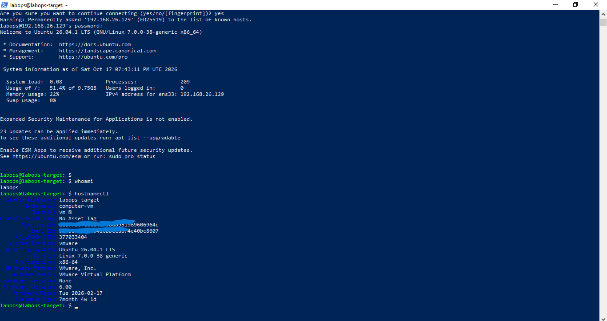

# VMware LabOps Dashboard

This is a learning project for VMware automation.

The project uses Python and Streamlit to control and monitor virtual machines.

The dashboard will show:

- VM status: on or off
- Buttons to start, stop, and restart VMs
- Automation logs
- VM health checks
- CPU, memory, and disk information
- Snapshots before important changes

My goal is to learn Python, VMware, Linux, automation, logs, and monitoring.

This project is made for my IT portfolio and job interview practice.

<h1 align="center">VMware LabOps Dashboard</h1>

  Python automation, VM monitoring, SSH, logs, and a Streamlit dashboard.

  

  <em>
    Target architecture. Ubuntu Server and SSH are installed.
    Python automation and the dashboard will be built step by step.
  </em>

<h4 align="center">Img Project - VMware_LabOps_Dashboard 🥰 🚀</h4>

    <table>
        <tr>
            <td style="width: 50%; text-align: center;">
                
                
VMware Workstation

            </td>
            <td style="width: 50%; text-align: center;">
                
                
Users_user_language_profiles_BeekeeperStudio

            </td>
        </tr>
    </table>

   
   

<h4 align="center">Img Project - VMware_LabOps_Dashboard 🥰 🚀</h4>

    <table>
        <tr>
            <td style="width: 50%; text-align: center;">
                
                
VMware Workstation

            </td>
            <td style="width: 50%; text-align: center;">
                
                
SSH_VM_labops_SSH from Windows to Ubuntu Server

            </td>
        </tr>
    </table>

   
   

  <h4 align="center">Img Project - VMware_LabOps_Dashboard 🥰 🚀</h4>

    <table>
        <tr>
            <td style="width: 50%; text-align: center;">
                
                
hostnamectl_VM

            </td>
            <td style="width: 50%; text-align: center;">
                
                
First checkpoint_VM_Snapshot

            </td>
        </tr>
    </table>

   
   

